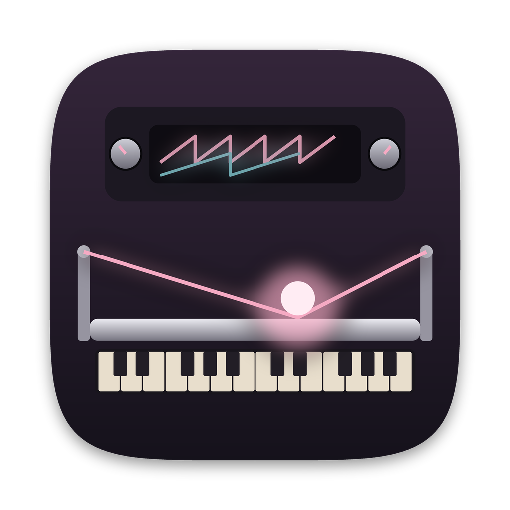

<p align="center"></p>

# Траутониум для тачпада MacBook

Электронный инструмент в духе **Mixtur-Trautonium** Оскара Залы, на котором играют прямо на тачпаде MacBook. Где палец, там высота тона; как сильно нажимаете, так громко и ярко звучит.

На настоящем траутониуме музыкант прижимал натянутую проволоку к металлической шине. Место касания задавало высоту, плавно, без клавиш, а сила нажатия — громкость. Тачпад с Force Touch умеет то же самое: он знает, где лежит каждый палец и с какой силой он давит.

Это отдельный проект, форк репозитория [tanukiichii/tutorials](https://github.com/tanukiichii/tutorials/tree/main/trautonium). Он развивается независимо и в основной репозиторий не вливается. В основе лежит программа автора `trautonium_line_control.c`: она хранится в папке `original/` без изменений и собирается командой `make original`. Из неё взяты субгармонические делители и таблицы формант гласных, всё остальное сделано заново.

---

## Возможности

**Игра**
- **Два мануала, как у Залы.** Верхняя половина тачпада — мануал I, нижняя — мануал II, у каждого свой тембр.
- **Сила нажатия для каждого пальца** без «клика»: громкость и яркость звука.
- **Поли и моно.** По умолчанию каждый палец — свой голос, можно брать аккорды. В режиме «Моно» второй палец перехватывает ноту, как на проволоке.
- **Мягкое притяжение к нотам.** Скользишь свободно, а когда палец останавливается, высота сама «доезжает» до чистой ноты. Вибрато сохраняется.
- **Лады** (мажор, минор, пентатоники, блюз…) с подсветкой ступеней.
- **Хаптика.** На каждой ноте тачпад слегка щёлкает, так что можно играть не глядя.
- **Ноты с клавиатуры**, как в исходной программе.

**Звук**
- Пила или «неон» (форма генератора на неоновой лампе) и четыре субгармоники f/N.
- Шум «дыхания», медленный дрейф высоты, формантные фильтры гласных A E I O U.
- Огибающая (атака, спад, сустейн, затухание), в том числе **ударный режим** для колоколов и щипков.
- Стерео-эхо в стиле ленточного и реверберация.
- 14 заводских пресетов и свои.

**Удобство**
- Приложение с иконкой, запуск двойным щелчком.
- Калибровка нажима под руку за 20 секунд.
- Настройки сохраняются сами.
- **Запись игры в WAV** одной клавишей, выбор аудиовыхода.
- Режим сцены на весь экран, справка, подсказка к каждому параметру.
- Блокировка жестов macOS на время игры.

---

## Что нужно

- Mac с Force Touch тачпадом: любой MacBook на Apple Silicon, MacBook Pro с 2015 года, MacBook Air с 2018 года или внешний Magic Trackpad 2/3. На старых тачпадах без Force Touch программа тоже работает, но громкость тогда зависит от площади касания, а не от силы.
- macOS 13 или новее.
- Наушники или колонки: встроенные динамики плохо передают низкие субгармоники.

## Установка с нуля

Все команды вводятся в **Терминале** (⌘ + пробел, набрать «Терминал»).

**1. Компилятор Apple**

```bash
xcode-select --install
```

В открывшемся окне нажмите «Установить» и дождитесь конца (5–15 минут). Если Терминал ответит, что инструменты уже установлены, переходите дальше.

**2. Homebrew**

```bash
/bin/bash -c "$(curl -fsSL https://raw.githubusercontent.com/Homebrew/install/HEAD/install.sh)"
```

Установщик попросит пароль от Mac. Символы при вводе не видны, это нормально. Затем выполните три строки, чтобы команда `brew` находилась (для Mac на Apple Silicon):

```bash
echo >> ~/.zprofile
echo 'eval "$(/opt/homebrew/bin/brew shellenv)"' >> ~/.zprofile
eval "$(/opt/homebrew/bin/brew shellenv)"
```

**3. Библиотека SDL2**

```bash
brew install sdl2
```

**4. Сборка**

Скачайте этот репозиторий: **Code → Download ZIP** на странице GitHub, затем распакуйте. В Терминале напечатайте `cd ` (с пробелом), перетащите папку проекта из Finder в окно и нажмите Enter. Затем:

```bash
make app
open build/Trautonium.app
```

Чтобы приложение лежало в «Программах» и находилось через Launchpad и Spotlight:

```bash
make install
```

После этого Терминал больше не нужен.

---

## Первый запуск

Программа предложит **откалибровать нажим**:

1. Нажмите пробел и коснитесь тачпада едва-едва, пока полоса не заполнится.
2. Уберите палец: следующий шаг начнётся, только когда тачпад свободен.
3. Нажмите сильно, как в самом громком месте. Полоса растёт, только пока нажатие заметно сильнее лёгкого.
4. На шаге «Проверка» понажимайте в разных местах и посмотрите на уровни. Пробел сохраняет результат.

Повторить калибровку можно в любой момент через ⌘K.

## Как играть

**Пробел** включает игру: рамка тачпада на экране становится розовой, курсор пропадает. **Esc** возвращает курсор и режим настройки.

- **Высота.** Положение пальца слева направо. На экране видна шкала нот, рядом с каждым пальцем написано, какая это нота, сколько центов отклонения и сколько грамм нажима. Покачивание пальцем даёт вибрато.
- **Громкость и яркость.** Сила нажатия. Насколько нажим открывает фильтр, задаёт параметр «Нажим → яркость».
- **Поли и моно** (клавиша P). В «Поли» каждый палец звучит сам по себе. В «Моно» звучит последний прижатый палец, а отпустишь его — снова зазвучит предыдущий. Это классическая техника траутониума, удобная для мелодий.
- **Притяжение к нотам** (клавиша W). «Мягкое» исправляет интонацию, когда палец останавливается, но не мешает скольжению. «Жёсткое» оставляет только ноты лада.
- **Лад и тоника** (T и Shift+T). Ступени лада подсвечиваются, хаптика щёлкает только на них, к ним же тянет притяжение.
- **Мышь.** Без тачпада можно играть мышью: зажмите кнопку на полосе мануала. Чем ниже точка внутри полосы, тем громче.
- **Сцена** (⌘F). Окно на весь экран: только тачпад и крупные названия нот.

**Ноты с клавиатуры** устроены как в исходной программе. Нижний ряд Z X C V B N M , . / — белые клавиши, средний ряд A S F G J K L ' — чёрные. Звучат ноты от G# до C#, отсчёт идёт от левого края выбранного мануала. Клавиши работают при любой раскладке, на русской это ф, я, ы, ч… и э.

## Звук

Каждый мануал — отдельный инструмент (вкладки «Мануал I» и «Мануал II»). Если навести курсор на параметр, внизу панели появится описание.

| Раздел | Параметры |
|---|---|
| **Высота** | нота у левого края, диапазон (октав на ширину тачпада), режим поли/моно, портаменто, притяжение к нотам |
| **Тембр** | форма волны (пила или неон), основной тон, четыре субгармоники (делитель f/N и уровень в одной строке), шум, дрейф, гласная и голос формант |
| **Фильтр** | яркость (срез), резонанс, нажим → яркость |
| **Огибающая и громкость** | атака, спад, сустейн, затухание, громкость мануала |

- **Субгармоники.** Тоны в 2, 3, 4… раз ниже основного, полученные делением частоты, как в Mixtur-Trautonium. Ряд f/2, f/3, f/4, f/5 даёт органно-хоровой звук Залы, f/3, f/5, f/7, f/9 — призрачный.
- **Неон.** Генератор траутониума — неоновая лампа и конденсатор: напряжение растёт по кривой заряда и резко сбрасывается. Получается пила с более мягким верхом.
- **Ударный режим.** Сустейн 0: звук гаснет сам, даже если палец лежит, как колокол или щипок. Каждый новый палец (и перехват ноты в «Моно») — новый удар.
- **Дрейф.** Медленное случайное плавание высоты до ±10 центов. Звук становится живее, в аккордах появляются лёгкие биения.

Во вкладке «Общие» звучание дополняют реверберация и **эхо**: громкость, время и количество повторов. Эхо стерео, повторы с каждым разом темнеют, а при изменении времени на ходу высота повторов плавно «плывёт», как у ленты.

## Пресеты

| Пресет | Характер |
|---|---|
| Микстура | звук по умолчанию: субгармоники Залы, гласная A на нижнем мануале |
| Хор | мягкая атака, гласные, широкий зал |
| Орган | ряды субгармоник по октавам, только чистые ноты |
| Бас | глубокий бас на нижнем мануале |
| Птицы | высокие резонансные вскрики (в честь звуков Залы к «Птицам» Хичкока) |
| Голос | мелодия гласными с мягким притяжением |
| Виолончель | тёплые глиссандо, нажим как смычок |
| Унтертоны | нечётные субгармоники, неон, эхо |
| Пентатоника | минорная пентатоника от A: фальшивить почти невозможно |
| Чистая пила | голый генератор без обработки, чтобы услышать основу |
| Колокол | ударный звук с длинным хвостом |
| Щипок | короткий ударный звук, нажим открывает фильтр |
| Ветер | шум дыхания, гласная U, дрейф, эхо |
| Космос | неон, длинное эхо, медленная атака |

Название текущего пресета показано вверху справа. Щелчок по нему открывает список, стрелки ‹ › (или ⌘← ⌘→) листают. Точка после названия означает несохранённые изменения.

- **Сохранить** (⌘S) записывает изменения в свой пресет. Если выбран заводской, программа предложит новое имя.
- **Сохранить как…** (⇧⌘S) создаёт новый пресет.
- **⌘Z** возвращает звучание, которое было до переключения пресета. Повторное нажатие отменяет возврат.

В пресет входит звучание: оба мануала, раскладка, лад, реверберация и эхо. Калибровка, хаптика, аудиовыход и прочие настройки игры хранятся отдельно и при смене пресета не меняются.

## Запись и аудиовыход

- **⌘R** начинает и останавливает запись. В заголовке горит красный значок с таймером. Пишется ровно то, что слышно, в WAV (24 бит, 48 кГц, стерео), в папку **Музыка → Trautonium**. Кнопка «Папка записей» во вкладке «Общие» открывает её в Finder.
- **Аудиовыход** выбирается во вкладке «Общие». «Системный» означает то же устройство, что у всего Mac. Если выбранное устройство отключить, звук сам перейдёт на системный выход, а когда устройство вернётся — обратно на него.

## Клавиши

| Клавиша | Действие | Клавиша | Действие |
|---|---|---|---|
| Пробел | играть / настраивать | E | портаменто |
| Esc | выйти из игры или сцены | T / Shift+T | лад / тоника |
| ⌘F | сцена на весь экран | Y | раскладка: 2 или 1 мануал |
| Tab | мануал I / II / общие | R | реверберация |
| 1–5 | гласная A E I O U | H | хаптика |
| 0 | без гласной | D | источник нажима |
| 6 | голос формант | 7 / 8 | полное нажатие ± |
| [ ] | октава вниз / вверх | ⌘← ⌘→ | предыдущий / следующий пресет |
| − = | диапазон | ⌘S / ⇧⌘S | сохранить / сохранить как |
| ↑ ↓ | яркость | ⌘Z | вернуть предыдущее звучание |
| ← → | резонанс | ⌘K | калибровка нажима |
| P | поли / моно | ⌘R | запись в WAV |
| W | притяжение: выкл / мягкое / жёсткое | ⌘/ | справка |
| A Z S X … / ' | ноты с клавиатуры | ⌘Q | выход |

## Настройка macOS

- **Жесты тремя и четырьмя пальцами** (Mission Control, смена рабочих столов) мешают аккордам. Есть два способа:
  - **Блокировка в программе** (вкладка «Общие» → «Блокировать жесты»). При первом включении macOS попросит разрешение «Универсальный доступ»: включите «Траутониум» в Системных настройках → Конфиденциальность и безопасность → Универсальный доступ. Программа сама заметит разрешение, переключать настройку ещё раз не нужно. Жесты глушатся только пока идёт игра.
    Приложение подписано локальной подписью, поэтому после каждой **пересборки** macOS считает его новой программой и разрешение нужно выдать заново. Программа сама удаляет устаревшую запись и снова показывает запрос: достаточно включить переключатель ещё раз.
  - **Надёжный способ** — отключить эти жесты или перевести их на четыре пальца в Системных настройках → Трекпад → Другие жесты.
- **Принудительное нажатие и тактильный отклик** (Системные настройки → Трекпад). Если при сильном нажиме мешает «глубокий» щелчок, его можно отключить: чтение силы и щелчки на нотах от этого не пропадут.

## Где что хранится

| Что | Где |
|---|---|
| Настройки, калибровка, текущее звучание | `~/Library/Application Support/Trautonium/settings.ini` |
| Свои пресеты (текстовые файлы, их можно отправлять друзьям) | `~/Library/Application Support/Trautonium/Presets/` |
| Записи | `~/Music/Trautonium/` |

Чтобы начать с чистого листа, удалите папку `~/Library/Application Support/Trautonium` (свои пресеты тоже удалятся).

---

## Как это устроено

```
trautonium/
├── Makefile                 одна строка: include build.mk
├── build.mk                 сборка
├── README.md
├── src/
│   ├── app.c                окно, панель параметров, пресеты, калибровка, справка, сцена
│   ├── synth.c / synth.h    звук: голоса, субгармоники, огибающие, фильтры, форманты, эхо, реверберация
│   ├── presets.c / .h       заводские и свои пресеты, автосохранение настроек
│   ├── recorder.c / .h      запись в WAV
│   ├── ui.c / ui.h          рисование: текст системным шрифтом, фигуры
│   ├── trautonium.h         общие типы и состояние
│   └── macos/
│       ├── mt_input.m / .h       тачпад: все пальцы, сила нажатия, хаптика, перезапуск после сна
│       └── platform_mac.m, platform.h   шрифты, папки, блокировка жестов
├── resources/               Info.plist, иконка (Trautonium.icns, icon.png)
├── tools/make_icon.py       скрипт, который рисует иконку (Python + Pillow)
├── original/                исходная программа автора без изменений
└── build/                   появляется при сборке, в git не попадает
```

**Тачпад.** Стандартный API macOS отдаёт силу нажатия одну на весь тачпад и только после щелчка. Поэтому программа читает тачпад через приватный фреймворк Apple MultitouchSupport, тот же, что используют [OpenMultitouchSupport](https://github.com/Kyome22/OpenMultitouchSupport) и [TrackWeight](https://github.com/KrishKrosh/TrackWeight). Для каждого касания он даёт позицию, силу в граммах и площадь, около 100 раз в секунду. После сна Mac тачпад открывается заново. Если фреймворк недоступен, программа переходит на стандартные события (мультитач без силы) или на мышь. Что именно работает, написано под заголовком окна.

**Путь звука.** Голос: генератор (пила или неон, без алиасинга благодаря PolyBLEP) + 4 субгармоники + шум → фильтр яркости, который открывается нажимом → огибающая × громкость от нажима. Дальше голоса складываются в мануал, проходят через банк из четырёх формант и чуть разводятся по панораме: мануал I левее, II правее. В конце — эхо, Freeverb и мягкое ограничение. Управление пересчитывается каждые 5,3 мс, высота и громкость сглаживаются, поэтому щелчков нет.

**Субгармоники.** Субгармоника f/N получается настоящим делением частоты: счётчик периодов основного тона, как в делителях траутониума. Поэтому она жёстко привязана к основному тону и не «плывёт» относительно него.

**Мягкое притяжение.** Программа следит за сглаженной позицией пальца. Пока палец скользит быстрее примерно 3,5 полутона в секунду, высота точно следует за ним. Когда он останавливается, поправка плавно подтягивает высоту к ближайшей ступени лада. Поправка прибавляется к живой позиции, поэтому вибрато остаётся, а центр ноты становится чистым.

## Сборка

| Команда | Что делает |
|---|---|
| `make app` | собрать `build/Trautonium.app` (библиотеки SDL упакованы внутрь) |
| `make install` | собрать приложение и положить в «Программы» |
| `make` | собрать программу `build/trautonium_touch` без упаковки |
| `make run` | собрать и запустить из Терминала (видны сообщения программы) |
| `make doctor` | проверить, всё ли установлено |
| `make original` | исходная программа автора (нужен `brew install sdl2_ttf`) |
| `make clean` | удалить папку `build` |

## Если что-то не работает

| Симптом | Что сделать |
|---|---|
| `xcrun: error: invalid active developer path` | не установлен компилятор: `xcode-select --install` |
| `command not found: brew` | не выполнены три строки после установки Homebrew (шаг 2) |
| `Не найден SDL2` при сборке | `brew install sdl2` |
| Приложение с другого Mac не открывается: «не удалось проверить разработчика» | щелчок правой кнопкой по приложению → «Открыть», или Системные настройки → Конфиденциальность и безопасность → «Всё равно открыть» |
| Под заголовком написано «MultitouchSupport недоступен» | звук будет, но без силы нажатия. Откройте issue и приложите вывод `make run`: возможно, в новой macOS что-то поменялось |
| Громкость почти не меняется от нажима | пройдите калибровку (⌘K) или выберите другую кривую нажима во вкладке «Общие» |
| Касания не видны совсем | Системные настройки → Конфиденциальность и безопасность → Мониторинг ввода: разрешите программе (или Терминалу, если запускаете из него) и перезапустите её |
| После сна Mac касания перестали читаться | программа перезапускает тачпад после пробуждения; если не помогло, выйдите из неё (⌘Q) и откройте снова, а лучше откройте issue |
| «Блокировать жесты» показывает «Ждёт доступа» | включите «Траутониум» в Настройках → Универсальный доступ или нажмите «Выдать разрешение для жестов…» во вкладке «Общие» |
| Сильное нажатие одного пальца поднимает громкость другого | датчики силы стоят по углам тачпада, и macOS сама делит общую силу между пальцами. В режиме «Поли» это иногда заметно. Режим «Площадь» (клавиша D) различает пальцы лучше |
| Верхний и нижний мануалы перепутаны | в `src/macos/mt_input.m` в строке `p->y = 1.0f - t[i].normalized.pos.y;` уберите `1.0f - ` и пересоберите |
| Запись не появилась в «Музыке» | если папка недоступна, записи сохраняются в `~/Library/Application Support/Trautonium/Recordings` |

## Ограничения

- MultitouchSupport — недокументированный API Apple. Он стабилен много лет, но обновление macOS теоретически может его сломать. На такой случай есть запасные режимы.
- Тачпад читается, только пока окно программы активно и включена игра.
- Хаптика срабатывает, только когда палец лежит на тачпаде, так устроено железо.
- Приложение подписано локальной подписью, а не сертификатом Apple. На своём Mac это незаметно, на чужом нужно один раз разрешить запуск, а разрешение для блокировки жестов слетает при каждой пересборке.
